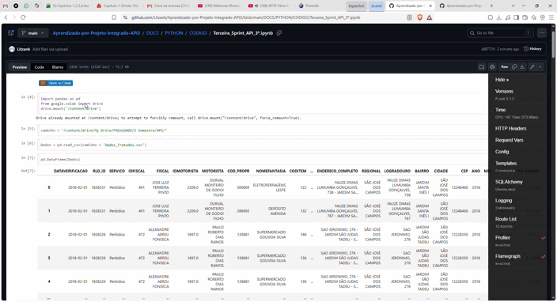

# 📌 MVP - [Aprendizado-por-Projeto-Integrado-API3]

## 🎯 Propósito do MVP

## • Qual problema resolve?
Evolução e reorganização estrutural do BI, dividindo a apresentação em três seções bem definidas para tornar a visualização dos dados mais agradável, fluida e organizada para o usuário.

## • Qual hipótese será validada?
A nova divisão estrutural em três partes (capa, painel principal e seção de apoio) melhora a interpretação das informações e a experiência visual na entrega do dashboard em relação à sprint anterior.

## • Qual valor será entregue ao usuário final?
Um layout de BI totalmente remodelado e mais intuitivo, dividido estrategicamente entre capa de apresentação, dados principais consolidados e seções complementares de apoio analítico.

---

# 📝 Descrição da Solução
## • Funcionalidades principais incluídas
Reformulação completa do layout do Power BI, estruturado agora em três partes distintas: introdução/capa visual, painel com os dados essenciais e uma seção adicional com novos elementos complementares.

---

## 👥 Personas / Usuários-Alvo
- **Persona 1:** Marcus Nascimento, Cliente direto para contato sobre atualizações e feedbacks, querem um programa rápido, responsivo, acessível e que disponibilize informações necessárias de maneira clara.
- **Persona 2:** Carlos Eduardo - Orientador de Projeto - Responsável por auxiliar no desenvolvimento do projeto.

---

## 🔑 User Stories (Backlog do MVP)
| ID  | User Stories (Sprint 2)                                                                                                     | Prioridade | Estimativa |
|-----|-----------------------------------------------------------------------------------------------------------------------------|------------|------------|
| US06 | Como gestor de projeto, quero a reestruturação do BI em três partes (capa, painel principal e dados complementares), para organizar melhor a visualização das informações. | Alta | 01 |
| US07 | Como gestor de projeto, quero a adição de uma capa visual no início do BI, para dar uma introdução mais agradável ao painel. | Média | 02 |
| US08 | Como gestor de projeto, quero o agrupamento dos dados essenciais na segunda seção, para manter o histórico e a base principal de análises. | Alta | 03 |
| US09 | Como gestor de projeto, quero a adição de novas métricas e elementos na terceira seção, para enriquecer o conteúdo apresentado. | Média | 04 |

---

## 📅 Sprint(s) Relacionadas
| Sprint | Entregas Principais | Status |
|--------|---------------------|--------|
| 01 | Entrega dos dashboards iniciais, filtros de informações e demonstrações de origem e destino | Concluído |
| 02 | Reorganização do layout do BI em três partes (capa, painel principal e seção complementar com novos dados) | Em andamento |
| 03 | Finalização do produto, integração de geolocalização e botões de navegação | A Fazer |

---

## 🧳 Critérios de Aceitação

- Layout do BI reorganizado e dividido em três partes (capa, painel principal e elementos complementares).
- Inclusão bem-sucedida de capa visual para introdução do painel.
- Organização aprimorada dos dados mantidos da versão anterior junto aos novos complementos.

---

## 📈 Métricas de Validação

- Número de seções estruturadas no BI: 3
- Quantidade de dashboards desenvolvidos: 1
- Quantidade de filtros implementados: 4
- Validação da nova estrutura visual com a equipe: Em progresso
- Feedback do usuário sobre o novo layout em três partes: Em avaliação

---

## 🚀 Próximos Passos
- Implementação dos dados de geolocalização para refinar os mapas do projeto.
- Desenvolvimento e inserção de botões de navegação rápida entre as seções e a capa do BI.
- Realização dos ajustes finais para preparação da entrega da próxima sprint.
  
---

## 📂 Anexos / Evidências

- PowerBI

---

- PYTHON

  

